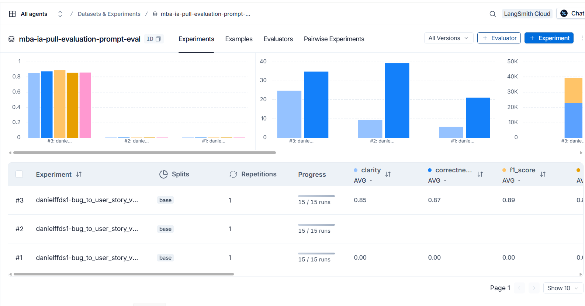

# Pull, Otimização e Avaliação de Prompts com LangChain e LangSmith

Desafio do módulo de Prompt Engineering: pull de um prompt de baixa qualidade do
LangSmith Prompt Hub, refatoração com técnicas avançadas de Prompt Engineering,
push do prompt otimizado e avaliação automática por 5 métricas customizadas
(Helpfulness, Correctness, F1-Score, Clarity, Precision), todas exigindo nota
mínima de 0.8.

## A) Técnicas Aplicadas (Fase 2)

O prompt original (`prompts/bug_to_user_story_v1.yml`) não define persona, não
tem exemplos, não trata edge cases e duplica a variável `{bug_report}` no
system e no user prompt. O prompt otimizado (`prompts/bug_to_user_story_v2.yml`)
aplica 3 técnicas:

### 1. Role Prompting

**Por quê:** sem uma persona definida, o modelo tende a gerar texto genérico e
inconsistente em tom. Definir uma persona específica ancora o estilo e o nível
de detalhe da resposta.

**Como foi aplicado:** o `system_prompt` abre definindo a persona explicitamente:

> "Você é um Product Manager Ágil Senior, com 10 anos de experiência
> traduzindo relatos de bugs de usuários e suporte técnico em User Stories
> claras para squads de desenvolvimento."

### 2. Few-shot Learning (obrigatório)

**Por quê:** é a técnica com maior impacto na qualidade da saída para este
tipo de tarefa — exemplos concretos ensinam o formato exato esperado (muito
mais eficaz do que apenas descrever o formato em texto).

**Como foi aplicado:** 3 exemplos completos de entrada/saída no `system_prompt`,
cobrindo os 3 níveis de complexidade do dataset:
- Exemplo 1 — bug simples (sem contexto técnico)
- Exemplo 2 — bug médio (contexto técnico leve)
- Exemplo 3 — bug complexo, com logs e múltiplos critérios, incluindo a seção
  "Contexto Técnico"

### 3. Chain of Thought (CoT)

**Por quê:** bugs reais frequentemente misturam sintoma, causa técnica e
impacto de negócio. Pedir ao modelo para separar esse raciocínio em etapas
(persona → comportamento esperado → valor de negócio → complexidade) reduz a
chance de ele pular direto para uma User Story rasa.

**Como foi aplicado:** uma seção "COMO RACIOCINAR" instrui o modelo a seguir 4
passos internos antes de escrever a resposta, com uma instrução explícita para
**nunca expor esse raciocínio na saída final** — apenas usá-lo para organizar a
resposta formatada.

### Outras melhorias

- Regras explícitas de formato (estrutura fixa: "Como um... eu quero...
  para que...", 3-7 Critérios de Aceitação em formato Given-When-Then).
- Regra de edge case para bugs complexos (seção "Contexto Técnico" só quando o
  relato tiver logs/stack traces/erros).
- Regra contra alucinação: se o relato for vago, não inventar números ou
  nomes de sistema.
- Separação clara de System Prompt (persona + regras + exemplos) e User
  Prompt (apenas o relato do bug a ser convertido).

## B) Resultados Finais

### Comparação v1 → v2

| Aspecto | v1 (original) | v2 (otimizado) |
|---|---|---|
| Persona | Nenhuma | Product Manager Ágil Senior |
| Few-shot | Nenhum exemplo | 3 exemplos (simples/médio/complexo) |
| Raciocínio | Nenhum | Chain of Thought em 4 passos (interno) |
| `{bug_report}` | Duplicado no system e no user prompt | Só no user prompt |
| Edge cases | Não tratados | Contexto Técnico condicional, anti-alucinação |
| Formato de saída | Vago ("User Story gerada:") | Estrutura fixa e obrigatória |

### Métricas (experimento `danielffds1/bug_to_user_story_v2`)

```
Métricas Derivadas:
  - Helpfulness: 0.86 ✓
  - Correctness: 0.88 ✓

Métricas Base:
  - F1-Score: 0.91 ✓
  - Clarity: 0.87 ✓
  - Precision: 0.85 ✓

MÉDIA GERAL: 0.8782
✅ STATUS: APROVADO - Todas as métricas >= 0.8
```

Todas as 5 métricas ficaram acima do limiar de 0.8 já na primeira iteração
após aplicar as 3 técnicas acima.

### Evidências no LangSmith

- Dataset de avaliação (15 exemplos) com o experimento aprovado, link público:
  https://smith.langchain.com/public/961f36e5-a814-4f44-9916-0df6b72c788d/d
- Link do experimento (workspace):
  https://smith.langchain.com/o/6ecfc039-1b04-4300-aa70-51b0fc98c689/datasets/51b76a85-f838-4ddc-a00f-4bb9db33130b/compare?selectedSessions=cd123648-8579-469a-b642-5c44a8028061
- Prompt otimizado publicado publicamente no Hub:
  https://smith.langchain.com/prompts/bug_to_user_story_v2/3c06b487



*A imagem mostra as iterações de avaliação: a primeira (modelo de avaliação
indisponível) e a segunda (cota do Gemini free tier esgotada) com notas 0.00,
e a terceira — a usada na entrega final — com todas as métricas acima de 0.80.*

## C) Como Executar

### Pré-requisitos

- Python 3.10+
- Conta no [LangSmith](https://smith.langchain.com) com handle público do Hub
  (veja a seção "Handle do LangSmith Hub" abaixo)
- API key do [Google AI Studio](https://aistudio.google.com/app/apikey)
  (Gemini, usado neste projeto) ou da [OpenAI](https://platform.openai.com/api-keys)

### Handle do LangSmith Hub

O LangSmith identifica prompts publicados por um handle público
(`handle/nome_do_prompt`). Ele não existe por padrão — é criado na primeira
vez que você torna um prompt público:

1. LangSmith → **Prompts** → crie um prompt qualquer
2. Três pontinhos (⋯) ao lado de **Playground** → **Make Public**
3. Defina seu handle (é definitivo depois de confirmado)

### Setup

```bash
# Clonar o repositório
git clone https://github.com/<seu usuario>/mba-ia-pull-evaluation-prompt.git
cd mba-ia-pull-evaluation-prompt

# Criar e ativar o ambiente virtual
python3 -m venv venv
source venv/bin/activate        # Linux/Mac
venv\Scripts\activate           # Windows (cmd/PowerShell)

# Instalar dependências
pip install -r requirements.txt

# Configurar variáveis de ambiente
cp .env.example .env
# edite o .env preenchendo LANGSMITH_API_KEY, USERNAME_LANGSMITH_HUB,
# GOOGLE_API_KEY (ou OPENAI_API_KEY), LLM_MODEL e EVAL_MODEL
```

> **Nota sobre o free tier do Gemini:** a cota gratuita é baixa (na ordem de
> ~20 requisições/dia por modelo) e vinculada ao **projeto do Google Cloud**,
> não só à chave. Se esgotar a cota, crie uma nova API key em um **projeto
> novo** no Google AI Studio para obter uma cota zerada, em vez de gerar outra
> chave no mesmo projeto.

### Execução passo a passo

```bash
# 1. Pull do prompt ruim (v1) do LangSmith Hub
python src/pull_prompts.py

# 2. Editar prompts/bug_to_user_story_v2.yml com o prompt otimizado
#    (já incluso neste repositório)

# 3. Push do prompt otimizado (v2) para o LangSmith Hub
python src/push_prompts.py

# 4. Rodar a avaliação (cria/usa o dataset e o experimento no LangSmith)
python src/evaluate.py

# 5. Rodar os testes de validação do prompt
pytest tests/test_prompts.py -v
```

> **Windows:** se aparecer `UnicodeEncodeError` ao imprimir os emojis (✓/❌),
> rode os comandos com `PYTHONUTF8=1` antes, ex:
> `PYTHONUTF8=1 python src/evaluate.py` (PowerShell: `$env:PYTHONUTF8=1`).

## Tecnologias obrigatórias

- Linguagem: Python 3.10+
- Framework: LangChain (`langchain-core`)
- Plataforma de avaliação: LangSmith
- Gestão de prompts: LangSmith Prompt Hub
- Formato de prompts: YAML
- Provider de LLM: Google Gemini (`gemini-3.5-flash` para geração,
  `gemini-3.1-flash-lite` para avaliação)

## Estrutura do projeto

```
mba-ia-pull-evaluation-prompt/
├── .env.example
├── requirements.txt
├── README.md
├── docs/images/                   # Evidências no LangSmith
├── prompts/
│   ├── bug_to_user_story_v1.yml   # Prompt original (baixa qualidade)
│   └── bug_to_user_story_v2.yml   # Prompt otimizado
├── datasets/
│   └── bug_to_user_story.jsonl    # 15 exemplos de avaliação
├── src/
│   ├── pull_prompts.py            # Pull do LangSmith Hub
│   ├── push_prompts.py            # Push para o LangSmith Hub
│   ├── evaluate.py                # Avaliação automática (5 métricas)
│   ├── metrics.py                 # Implementação das métricas (LLM-as-Judge)
│   └── utils.py                   # Funções auxiliares
└── tests/
    └── test_prompts.py            # 6 testes de validação do prompt v2
```
